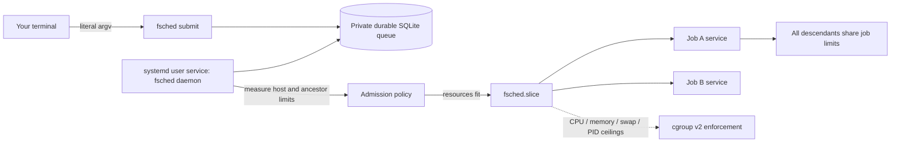

# FriendlyScheduler

`fsched` is a small, per-user job queue for a shared Linux host. Submit an ordinary
command, disconnect your terminal, and inspect it later. A systemd user service
runs the queue; jobs run in a constrained cgroup v2 slice with smaller per-job
limits. No batch script or cluster service is required.

**First draft, version 0.1.0.** The intended target is RHEL8 with unified cgroup v2
and Python 3.9 (`python39`). RHEL9 and Bazzite are future validation targets. This
is cooperative protection for shared compute, not isolation from a malicious user.
A real systemd user manager, delegated controllers, and persistent user sessions
are prerequisites. The development cloud host has no user bus; its successful
unit tests and packaging checks do not certify RHEL8 operation.



## Install from source

Ask your administrator to provide Python 3.9 or newer. RHEL8's original Python 3.6
is too old; use the supported `python39` stream/package for your site. The runtime
uses only Python's standard library. Installation uses pip/setuptools in a private
virtual environment and requires the usual Python package-index access.

```sh
git clone https://github.com/christophertubbs/FriendlyScheduler.git
cd FriendlyScheduler
PYTHON=python3.9 scripts/install.sh
export PATH="$HOME/bin:$PATH"
fsched doctor
```

The preferred executable location is `~/bin`. Select `~/.local/bin` explicitly if
that is your site's convention:

```sh
scripts/install.sh --bin-dir "$HOME/.local/bin"
```

Use `--no-start` to install on an image or before configuring systemd. This writes
the executable and units; it does not validate live scheduling:

```sh
scripts/install.sh --no-start
systemctl --user daemon-reload
systemctl --user enable --now fsched.service
fsched doctor
```

The installer hashes its managed files and refuses to overwrite unrelated binaries
or locally modified unit files. Keep local unit customizations in standard systemd
`.service.d`/`.slice.d` drop-ins. Repeating installation upgrades the private venv,
rewrites unmodified managed files, and restarts the worker. Running job services
are separate from the worker and are reconciled after restart. Do not change the
state directory during an upgrade with active jobs.

### System prerequisites and logout survival

An administrator must enable **unified cgroup v2** on RHEL8 and delegate `cpu`,
`memory`, and `pids` controllers to the user manager. RHEL8 often defaults to
cgroup v1 and may not delegate CPU to users. Changing boot arguments or system
unit configuration is a site administration decision; this installer does neither.
The kernel must expose `cpu.max`, `memory.max`, `memory.high`, `memory.swap.max`,
and `pids.max` in job cgroups. Missing hard enforcement prevents dispatch.

For jobs to survive **logout**, ask an administrator to run:

```sh
sudo loginctl enable-linger YOUR_USERNAME
```

A job being independent of its terminal does not prove the user manager will
survive logout. `fsched doctor` checks linger and reports readiness failures with a
nonzero exit. Use a normal SSH/login session with its real `XDG_RUNTIME_DIR` and
user bus. Do not point an arbitrary environment variable at another user's bus.

RHEL8's systemd 239 is the compatibility baseline: services use `Type=simple` and
properties available in that generation. Actual controller availability matters
more than the version number. Live validation on your target RHEL8 configuration
is required before trusting production workloads.

## Everyday commands

```sh
# Automatic CPU/memory, default wall limit of one day.
job=$(fsched submit /usr/bin/python3 analysis.py input.csv)
fsched list
fsched inspect "$job"
fsched logs "$job" --follow
fsched cancel "$job"
fsched list --all --json
```

Scheduler options **precede the executable**. Everything after it is a literal
argument to the job, including `--help`. A leading `--` is optional:

```sh
fsched submit --time-limit 2h --cpus 1.5 --memory 6GiB -- python3 analysis.py --help
fsched submit --cpus 0.25 --memory 256MiB --time-limit 20m /usr/bin/sleep 100
fsched submit /usr/bin/printf '%s\n' 'a space' '$HOME' '%n' 'a; b'
```

`submit` prints a random 32-character job ID **after** committing the queue record.
It checks that the installed worker is active; acceptance still does not promise
immediate execution or a successful result. Resource shortages leave jobs queued
with a blocked reason. A request exceeding the current protective ceiling is
rejected with that ceiling; an explicit request cannot bypass shared-host limits.

### Pipelines, virtual environments and reproducible commands

There is no implicit shell. Ask for one explicitly when you need a pipeline:

```sh
fsched submit --time-limit 1h /bin/bash -c 'set -o pipefail; ./generate | ./summarize'
fsched submit "$PWD/.venv/bin/python" model.py --epochs 10
fsched submit /usr/bin/env OMP_NUM_THREADS=1 OPENBLAS_NUM_THREADS=1 python3 fit.py
```

The working directory is captured at submission. Executables are resolved to
absolute paths then; files and dependencies must remain available until execution.
The job receives a minimal environment: `HOME`, a system `PATH`, `LANG=C.UTF-8`,
and `FSCHED_JOB_ID`. Your shell's aliases, exported variables, credentials, module
loads, and activated venv are not copied. Choose the venv interpreter explicitly
or write a deliberate wrapper for site-specific environments. Do not put secrets
in command arguments: inspect/history intentionally retains argv in private state.

### Inspect and cancellation semantics

```sh
fsched inspect "$job" --json   # argv, cwd, allocation, timestamps, result, unit
fsched logs "$job"            # journalctl output; system journal retention applies
fsched cancel "$job"          # durable cancellation intent, safe to repeat
```

Queued cancellation is immediate. Running cancellation is asynchronous: the worker
stops the entire service control group on its next reconciliation cycle (normally
about five seconds, longer when a manager operation is slow), sends SIGTERM and
escalates to SIGKILL after ten seconds. `inspect` shows the terminal `cancelled`
state when processed. A stopped worker cannot process running cancellation;
restart it or stop the exact unit shown by `inspect` with `systemctl --user stop`.
Hard runtime and cgroup limits continue to work without the worker.

Output goes to journald, which applies the host's journal retention/rate limits.
It is not a guaranteed complete scientific output archive. Write durable results
to files explicitly. Structured inspect output escapes job strings as JSON.

States are `queued`, `starting`, `running`, `succeeded`, `failed`, `cancelled`, and
`timed_out`. Successful transient services remain loaded long enough to record their
outcome. A crash between recording dispatch intent and contacting systemd is
ambiguous: reconcile adopts an existing deterministic unit or marks the job failed;
it never silently repeats the command. Running jobs interrupted by a reboot are
not automatically resubmitted. Queued work remains durable.

Every public command has `--help` with options and examples:

```sh
fsched --help
fsched submit --help
fsched doctor --help
```

CLI exits: `0` successful command/acceptance, `1` failed doctor readiness, `2`
invalid input or operational failure, `130` interruption. Help/version exit `0`;
job exit status is reported by `inspect`, not the original submission exit code.

## How resource decisions work

The scheduler reads CPU affinity, host memory availability, and all visible cgroup
ancestor CPU/memory ceilings and memory usage. A constrained parent takes precedence
over host totals. Hidden ancestry or unreadable critical measurements stop admission. Controller
files can be absent in unconstrained descendants or at the real cgroup root; the
probe keeps walking to apply every existing ancestor ceiling. Actual job and slice
enforcement still requires all configured controller files before execution.

Recent sharing is estimated from bounded, C-locale `last --since -14days -w -R`
records. It counts distinct usernames, excluding the calling user, names ending in
`.adm` or `.svc`, and boot/shutdown/history markers. It never stores login records.
Missing, empty, inaccessible, malformed, or capped history uses a visible fallback
of one other user. This estimate is approximate: log rotation, remote workloads,
and inactive accounts affect it; it is not an access-control or accounting system.

With `N` eligible other users, divide capacity by `max(2, N + 1)`:

| Protection | Policy |
| --- | --- |
| Aggregate CPU | At most capacity / shares; never more than 75% of capacity |
| Interactive memory reserve | max(2 GiB, 20% capacity), capped at half on small hosts |
| Aggregate memory | Minimum of capacity / shares, 70% capacity, capacity minus reserve |
| Automatic job | At most 2 CPU equivalents and 4 GiB, reduced to fit the budget |
| Available memory admission | New job plus interactive reserve must fit current headroom |
| Processes/threads | 128 per job, 512 across the job slice |
| Swap | Job slice and job swap limit zero; missing support blocks execution |
| Scheduling preference | CPUWeight=10, Nice=10, OOMScoreAdjust=500 |
| Wall time | Default 24 hours; explicit positive `s`, `m`, `h`, `d`, maximum 7 days |

On the example **16 logical CPUs / 70.3 GiB** host:

| Other recent users | Aggregate CPU ceiling | Aggregate memory ceiling |
| ---: | ---: | ---: |
| 0 or 1 | 8 CPU equivalents | 35.15 GiB |
| 3 | 4 CPU equivalents | 17.58 GiB |
| 7 | 2 CPU equivalents | 8.79 GiB |

Current free memory and active reservations can reduce admission further. CPU quota
is aggregate CPU time, not dedicated cores or an instantaneous-idleness guarantee.
Fractional parent quotas remain fractional; the scheduler never rounds them to one
full core. There is no guaranteed host-wide reservation between independent users.
For strict inter-account protection, administrators should also limit parent slices.

Both aggregate and per-job hard limits contain descendants. `MemoryHigh` is 90%
of each applied hard ceiling. When sharing increases, CPU quota can shrink while
jobs run. Memory hard limits do not shrink below existing job reservations: new
admissions stop until jobs drain, then the smaller ceiling applies. FIFO admission
can intentionally leave capacity idle behind a large waiting job; no silent backfill
or starvation policy is hidden in the first draft.

Memory pressure can still kill a job at its hard limit. This tool does not promise
all possible workloads will fit; inspect the outcome, reduce the workload, or wait
for resources rather than removing protections. GPU and I/O bandwidth scheduling,
checkpoint/restart, and a global multi-user queue are not implemented.

## XDG paths and private state

| Content | Location |
| --- | --- |
| Queue and daemon lock | `$XDG_STATE_HOME/fsched` (default `~/.local/state/fsched`) |
| Dedicated source venv and installer hashes | `$XDG_DATA_HOME/fsched` (default `~/.local/share/fsched`) |
| User unit files | `$XDG_CONFIG_HOME/systemd/user` (default `~/.config/systemd/user`) |
| Live user bus | Existing `$XDG_RUNTIME_DIR` provided by the login/session manager |
| Job logs | User systemd journal |

XDG base overrides must be absolute. The state directory is `0700`, files are
`0600`, and symlink/foreign-owned/public state is rejected. The daemon lock lives
with durable private state rather than relying on an invented runtime directory.
The installer records the chosen state base in its service environment. If you
customize `XDG_CONFIG_HOME`, ensure your user manager was started with that same
configuration base; changing it only in a terminal does not change unit search paths.
Paths containing `%`, `$`, or line breaks are rejected at the systemd boundary.
Source venv paths additionally cannot contain spaces because of kernel shebangs.

To uninstall, stop/disable `fsched.service`, cancel or stop active job services,
remove the managed executable and two managed unit files, then daemon-reload.
Retain state and results until you explicitly decide to delete them. Do not remove
an active job's venv/binary or queue while it is running.

## Development, tests and frozen builds

```sh
python3.9 -m venv .venv
. .venv/bin/activate
python -m pip install -e '.[dev]'
ruff check src scripts tests
ruff format --check src scripts tests
mypy src tests scripts
pytest --cov=fsched --cov-report=term-missing --cov-fail-under=85
scripts/build.sh
```

The source wheel is platform independent Python. PyInstaller bundles an executable:

```sh
python scripts/install.py --binary dist/fsched --no-start --bin-dir "$HOME/bin"
# From an extracted release bundle:
python3.9 install.py --binary ./fsched
```

The frozen executable needs no installed Python runtime; the supplied unit installer
still needs Python 3.9+. Local frozen builds inherit the build host's glibc baseline.
Release CI builds Linux x86_64 in a pinned **manylinux glibc 2.28** container to avoid
accidentally requiring Ubuntu's newer glibc on RHEL8. The bundle includes the binary,
installer, README and GPL license. Releases also include wheel, sdist and SHA256SUMS.
Check checksums before installation; checksum integrity is not a substitute for
trusting the release source. Other architectures are not built in this draft.

The release image's `/opt/python` interpreters are static tools for building wheels;
they cannot directly freeze this application. The workflow uses the pinned image's
`uv` to download a checksum-verified **shared CPython 3.11.17**, creates a managed
build venv, and freezes there while retaining glibc 2.28. `scripts/build.sh` checks
that PyInstaller can find shared `libpython` before building any artifacts. These
build paths and variables are configured by the workflow; no user-supplied secrets
or custom environment variables are needed.

To recover an already published release whose asset build failed, first merge the
workflow fix into the default branch. In **Actions → Release build → Run workflow**,
select the updated default branch and set `release_tag` to the existing exact tag,
such as `v0.1.0`. The workflow tests and checks out that tag's source, validates its
version, and attaches assets to the existing release. This avoids moving the tag or
rebuilding different application source under the same version. Re-running the old
failed run alone still uses its old workflow definition. Existing assets are not
overwritten automatically. The release token is provided by GitHub; repository
settings do not need to change.

Normal tests require no systemd service and use temporary private state. Tests cover
malformed options, literal argv, sharing monotonicity, tiny/nested cgroups, headroom,
concurrent writers, cancellation, restart ambiguity, terminal results, unsafe paths,
and installer preservation. The live suite is deliberately opt-in:

```sh
# Disposable host only, with installed/started worker and controller delegation.
python scripts/check_systemd.py --required
fsched doctor
FSCHED_SYSTEMD_TESTS=1 pytest -m systemd -v
```

It executes capped jobs and checks literal output, actual kernel controller files,
runtime expiry, descendant termination, and cancellation. PR CI runs Python 3.9,
3.11 and 3.13. Its Ubuntu integration job first creates an isolated temporary user
slice/service with CPU, memory, swap and PID ceilings and verifies both sets of
kernel controls. Unsupported delegation reports an explicit **SKIPPED** summary
and does not run the live suite; a successful preflight keeps subsequent worker,
doctor and test failures fatal. Missing root `cpu.max` alone is not a skip reason.
The preflight removes its unique temporary units and does not modify production
scheduler units. Its exit statuses are 0 (supported), 77 (unsupported), or 1 for
unsupported with `--required`; unexpected errors fail rather than becoming skips.
Release publication reuses that suite before building/uploading assets; a skipped
integration step remains an unvalidated capability, not evidence of live readiness. This is not a substitute for a RHEL8 test
matrix: confirm logout survival, enforcement, reboot behavior, SELinux policy and
site-specific delegation on a disposable RHEL8 host before production deployment.
No repository settings are changed by these workflows.

`SPEC.md` records the intended contract; `AGENTS.md` and `STYLE.md` contain the
provided development instructions. Generated Python carries the requested human
review markers. `.llm/` contains ignored local working notes and is not shipped.

## Troubleshooting

- **Cannot connect to user bus:** use a real login session; check `systemctl --user
  status`. A container with a systemctl binary is not necessarily a systemd host.
- **Required limits not enforced:** ask the administrator to verify unified cgroup
  v2 and cpu/memory/pids delegation. The scheduler intentionally does not run jobs
  unconfined to make an error disappear.
- **Queued for memory:** inspect the blocked reason; free memory may be below the
  interactive reserve even though total RAM is large. Reduce an explicit request
  only if the program can actually run with less.
- **Worker active but jobs stuck:** inspect `journalctl --user -u fsched.service`;
  failed cycles keep the queue intact and log actionable errors.
- **Unknown/missing history:** install the site's supported `last` provider if
  desired; conservative fallback is functional and reported in logs/doctor.
- **Job failed after reboot/worker crash:** inspect the recorded interruption.
  Resubmit deliberately if your command is safe to repeat.
- **Install refuses modified file:** preserve your edits and move customization to
  a drop-in; the installer will not overwrite them silently.

Licensed under GPL-3.0-only; see [LICENSE](LICENSE).
