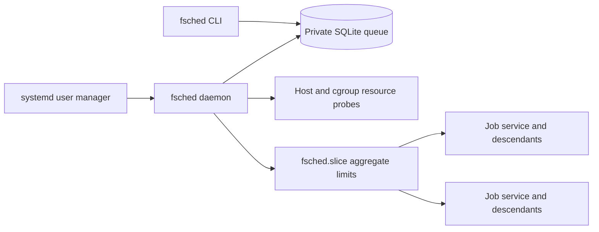

# FriendlyScheduler first-draft specification

Status: first implementation draft. Functional requirements below are implemented
and locally tested unless the acceptance evidence identifies a platform gap. This
is not a claim of RHEL8 certification.

## Purpose and boundaries

`fsched` submits ordinary commands to a durable, per-user scheduler on one Linux
host. Jobs survive the submitting terminal. The scheduler protects interactive
use by admitting work conservatively and enforcing cgroup limits through systemd.
No Slurm/PBS script, cluster service, root daemon, or shell command string is
required. The first supported target is RHEL8 with unified cgroup v2; RHEL9 and
Bazzite are subsequent validation targets.

This is cooperative resource management, not a security boundary against a
malicious account. Separate users' schedulers cannot enforce a combined host
quota without administrator-managed parent limits. GPU allocation, distributed
execution, priorities between accounts, and automatic checkpointing are outside
the first release.

## Command interface

- `fsched submit [options] [--] command [argument ...]`: persist a job and print
  its identifier. Preserve each argument literally; never invoke an implicit shell.
  Options precede the command; subsequent tokens belong to the submitted program.
  Support `--cpus`, `--memory`, and `--time-limit` overrides. A separate display-name option is deferred.
- `fsched list [--all] [--json]`: show queued and running jobs by default, with
  state, age, allocation, and blocked reason. All includes terminal history.
- `fsched inspect job_id [--json]`: show the command, directory, timestamps,
  requested/effective limits, unit, outcome, signal/exit status, and journal access instructions.
- `fsched cancel job_id`: transactionally cancel queued work or stop the entire
  running service control group. Repeated cancellation is safe.
- `fsched doctor [--json]`: report supported systemd properties, effective cgroup
  controllers, user-manager connectivity, linger, paths, resource probes,
  installation health, and actionable administrator steps. Fail readiness checks
  when required enforcement is unavailable.
- `fsched logs job_id [--follow]`: expose bounded job output without parsing it
  as terminal instructions in structured output.
- `fsched daemon`: internal foreground queue manager, normally started by systemd.

Every public command has detailed `--help`, units, defaults, examples, exit codes,
and explanations of queueing. Invalid identifiers and options fail before changes.
Duration and memory parsers reject zero, negative, NaN, infinity, overflow, and
ambiguous units. A successful submit means durable acceptance, not job success.

## Runtime architecture

Use the existing checkout during development; cloud tasks are already isolated
and do not need an additional Git worktree.

Install a user-manager service for the queue worker and a separate constrained
slice for jobs. Keep the daemon outside that job slice so saturated jobs cannot
consume its full allowance. Services use `Type=simple` for the systemd 239 baseline; do not assume newer
systemd features on RHEL8.
Use argument arrays through a supported interface or correctly encoded unit
arguments, never shell interpolation. Validate systemd escaping, percent
specifiers, spaces, newlines, and Unicode. Unit names use generated identifiers,
never user-controlled names. Pin the executable to an absolute installed path.

Terminal independence requires a working user manager. Logout survival additionally
requires administrator-enabled linger or an equivalent persistent user session.
Report missing linger prominently; never promise logout survival merely because
a transient service starts. Do not enable linger or modify system settings
without explicit administrator action.

## Resource policy

Probe online CPUs/affinity, host MemAvailable, and finite ancestor cgroup CPU,
memory, and PID limits. Account for tighter parent limits and current usage; host
totals alone are insufficient. A control file absent from an unconstrained group
or the cgroup root is not itself a measurement failure: continue to every visible
ancestor and apply its existing ceilings. Unreadable existing controls and missing
usage for a finite memory limit remain fatal. Independently require concrete kernel
limits on the actual job slice and service before dispatch/exec. Do not parse
localized human-readable tool output when kernel interfaces provide numeric values.

Estimate recent sharing from `last --since -14days -w`, parsing username records
and excluding reboot/shutdown/wtmp/btmp markers, the invoking user, and names
ending in `.adm` or `.svc`. Count distinct usernames, not sessions. Run with a
fixed locale and a bounded timeout/output. Do not retain login history. Missing,
truncated, inaccessible, or malformed history is unknown, not evidence of an idle
private host; use a documented fallback sharing count of one other user.

Proposed initial policy, subject to tests and measured refinement:

1. Let N be the other-user count and S = max(2, N + 1). The aggregate job CPU
   quota is at most effective CPUs / S, capped at 75% of effective capacity.
   Fractions of a CPU remain usable; do not impose a one-core minimum that
   exceeds a small parent quota. Set low CPU weight and positive nice level.
2. Reserve max(2 GiB, 20% of effective RAM), bounded so a small cgroup still has
   a usable but constrained allocation. The aggregate memory ceiling is the
   smaller of effective RAM / S and 70% of effective RAM, after reservation.
   Determine this against ancestor capacity rather than substituting current
   free memory for capacity. Use MemoryHigh below MemoryMax; disable job swap
   where supported and report when that protection is unavailable.
3. Default one job to at most two CPU equivalents and 4 GiB, reduced to fit the
   aggregate budget. Explicit requests may use the available aggregate budget,
   but cannot override protective ceilings. Never silently increase requests.
4. Admit only if queued requests fit the aggregate reservation ledger and
   observed free memory after the interactive reserve. Avoid double counting
   running jobs' reservations and resident memory. CPU quota is an enforced
   allowance, not a claim that instantaneous idle CPU is guaranteed.
5. Bound process count with aggregate and per-job TasksMax, including descendants.
   Configure a default 24-hour runtime ceiling; allow explicit positive durations
   up to a documented policy maximum. systemd enforces runtime and kill escalation
   even if the scheduler exits.

On the example 16-CPU, 70.3-GiB host with one other recent user, aggregate CPU is
at most eight CPU equivalents and aggregate memory at most 35.15 GiB before
current availability constrains admission. Defaults remain smaller per job.
With seven other users, the ceilings fall to two CPUs and about 8.79 GiB.
These are ceilings, not promises of free capacity or reserved physical cores.

Apply aggregate limits before dispatch. Recompute periodically and on admission;
shrinking a live memory hard limit can kill useful jobs, so first stop admissions
and lower soft pressure limits. Keep existing reservations visible and document
the bounded transition to stricter hard limits. Limit changes must never remove
enforcement. Requests that cannot currently fit stay queued with an explanation;
distinguish permanently impossible requests from temporary pressure. Preserve
FIFO fairness, documenting any bounded backfill rule rather than silently starving
large jobs. Fail closed when critical resource measurements or enforcement fail.

## Persistence and lifecycle

Use SQLite transactions and a single daemon lock. States are queued, starting,
running, succeeded, failed, cancelled, and timed_out. Persist dispatch intent
before starting the deterministic unit; reconcile systemd state after crashes
before retrying. Never rerun an ambiguously started command automatically.
Cancellation races with admission must resolve without launching cancelled work.
Record unit termination details before collecting transient units. A daemon
restart reconciles existing units and resumes the queue. Host reboot interrupts
running jobs; mark them failed/interrupted rather than silently replaying them.

Capture working directory, resolved executable, argv, and a documented environment
policy. Avoid persisting the complete submitting environment or secrets by default.
Allow explicit environment forwarding only with clear warnings and private files.
Queue state uses owner-only permissions; reject unsafe symlinks and foreign-owned
state paths. Logs use the user journal and its administrator-configured retention
and rate limits. Never load serialized Python code.

## Paths, installation, and compatibility

Use `$XDG_STATE_HOME/fsched` (default `~/.local/state/fsched`) for queue state and the singleton lock,
`$XDG_CONFIG_HOME/fsched` for configuration and user unit files under the standard
`systemd/user` directory, and the existing `$XDG_RUNTIME_DIR` for the session-provided bus. The daemon lock stays
with private durable state and is released by the kernel on process exit.
Reject relative XDG base paths according to the XDG specification. Do not use a
hard-coded `/run/user` path as proof that a user bus is available.

Prefer `~/bin/fsched`; support `~/.local/bin/fsched` explicitly. Provide a repeatable
installer using an isolated virtual environment and a PyInstaller build path.
Do not overwrite unrelated executables or remove user data on upgrades/uninstall.
Select and document a Python baseline available on RHEL8, including how it is
installed. A frozen Linux binary must be built against a compatible glibc baseline;
a modern Ubuntu PyInstaller artifact must not be labeled RHEL8-compatible.
Avoid mandatory nonubiquitous dependencies. Keep development dependencies separate.

## Verification and delivery

Tests must cover parsing and argv fidelity; missing or corrupt login history;
resource boundaries and monotonic sharing restrictions; small and nested cgroups;
low memory; unavailable controllers; systemd errors; failed startup; repeated
cancellation; concurrent submitters; daemon locking and crash reconciliation;
unknown job identifiers; SQLite failures; private paths and symlink attacks;
runtime expiry; descendant cleanup; and installer repeatability.

Run unit and mocked integration tests on every PR across supported Python versions.
Run real systemd/cgroup integration on a suitable Linux VM with an actual user
manager and delegated controllers. A skipped integration suite does not establish
RHEL compatibility. Release CI tests first, builds versioned source/wheel and
compatible frozen artifacts, smoke-tests installed CLI help, and publishes
checksums with least-privilege workflow permissions. Do not alter repository
settings. Pin external actions and constrain release triggers.

README examples must include simple submission, literal arguments, explicit shell
use, time limits, resource overrides, queued-resource explanations, inspection,
logs, cancellation, XDG paths, installation, administrator prerequisites, and
troubleshooting. Exclude `.llm/` from Git. Preserve existing license terms.

## First-draft acceptance evidence

A PR must report actual test counts and failures, which packaging paths were
executed, and whether a real RHEL8 host validated cgroup enforcement, logout
survival, timeout, and descendant termination. This cloud instance has cgroup v2
but no usable systemd user bus; live scheduling cannot be certified here.
The supplied Python instruction files have been applied verbatim as `AGENTS.md`
and `STYLE.md`. Generated Python retains their requested human-review markers.

### Evidence and remaining platform acceptance

- Local automated checks exercise the pure policy, private SQLite state, concurrent
  submissions, cancellation, startup ambiguity, terminal cleanup retry, fixed runner,
  CLI boundaries, installer preservation and malformed kernel limits.
- Live systemd integration is opt-in. PR CI on Ubuntu verifies delegated enforcement
  on isolated temporary slice/service cgroups before installing the worker. Only
  unsupported infrastructure yields an explicit skipped summary; application failures
  after a successful probe remain fatal. Root limit-file absence alone never skips
  the suite. The script's `--required` mode makes unavailable capability a failure
  for target-host certification. This cloud instance has no user bus, so its live
  suite is skipped and the updated workflow must be checked on GitHub Actions.
- RHEL8 cgroup delegation, real logout/reboot survival, SELinux behavior, RHEL9 and
  Bazzite remain external validation tasks. A frozen build from the current cloud
  host is a local smoke artifact, not a RHEL8-compatible release. Release CI uses
  a pinned glibc 2.28 image to produce the compatible-baseline x86_64 artifact.
- The implementation requires all CPU/memory/swap/PID controls. It fails closed
  rather than silently degrading swap or controller protection.
- History is unbounded in SQLite in this draft; job output is retained by journald.
  Automatic history pruning, environment forwarding and additional architectures
  are deliberately deferred and must not be advertised as implemented.
